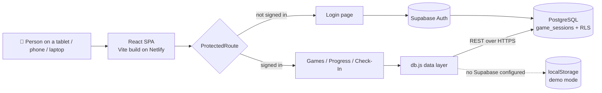
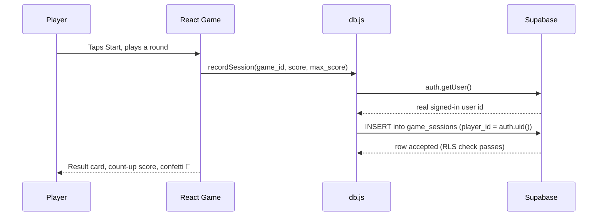

# 🧠 Mindful Minutes

mindfulminutesapp.netlify.app

Five short, colorful memory mini-games for older adults modeled on a
real, published cognitive-assessment tasks!

Built with **React + Vite + Tailwind CSS**, ready to deploy to **Vercel** or
**Netlify**, with an optional **Supabase** backend for real accounts and
persistent, cross-device score history.

---

## 🧰 Tech Stack

**Languages:** JavaScript (ES2022+) · JSX · HTML5 · CSS3 · SQL (PostgreSQL) · Markdown

| Layer | Tools |
|---|---|
| **Front end** | React 18, Vite, React Router DOM v6 |
| **Styling & motion** | Tailwind CSS, PostCSS, Autoprefixer, Framer Motion, canvas-confetti |
| **Data viz** | Recharts |
| **Backend as a service** | Supabase (PostgreSQL, Auth, REST API) |
| **Security** | Postgres Row Level Security (RLS), Supabase Auth JWT sessions |
| **Hosting & CI/CD** | Netlify (auto-deploy from GitHub), Vercel-compatible |
| **Tooling** | Git, GitHub, npm, VS Code |
| **Typography** | Google Fonts (Fredoka, Nunito) |
| **Collaboration** | Built with Claude (Anthropic) as an AI pair-programmer |

---

## 🏗️ System Design

### High-level architecture

### Data flow for one game session

---

## Why? 🇨🇲

I'm from Cameroon, and I've noticed a lot of cognitive decline in my personal community and it's even ran in my distant family as well.

Cognitive decline and dementia are a growing public health challenge in Cameroon, with overall cognitive impairment rates estimated between 21% and 33% among adults aged 60 and older.

I hope that helping even a few people in the world better their physical & mental health here will shed a light into other communities like my own!!!

---

## What's inside

| Game | Domain tested | Based on |
|---|---|---|
| 🌷 Garden of Words | Verbal / episodic memory | Rey Auditory Verbal Learning Test (RAVLT) |
| 🔢 Number Nest | Working memory | WAIS Digit Span |
| ✨ Firefly Path | Visuospatial short-term memory | Corsi Block-Tapping Test |
| ☀️ Sunbeam Tap | Processing speed / attention | Simple reaction-time task |
| 🙂 Friendly Faces | Associative / episodic memory | Face-Name Associative Memory Test (FNAME) |

Every game, color, text size, and threshold in this app is a deliberate
choice — the full reasoning lives on the in-app **`Science`** page, which doubles as documentation for anyone reviewing or extending this project.

---

## Why the assessment is deliberately limited

**This app is a screening companion, not a diagnostic tool**, and it's
built so it structurally can't become one. **Check-In** only
ever produces one of three outcomes:

1. Not enough data yet (fewer than 6 sessions, or fewer than 3 per game)
2. Scores look stable
3. Scores have shown a sustained downward trend — worth mentioning at your
   next doctor's visit

There is no code path that outputs a diagnosis, a risk score, or a
condition name. A single low score never triggers anything — only a
pattern sustained across several sessions does. The goal is to hand a
doctor better longitudinal information going into a real appointment, not
to replace one.

## Accessibility choices

- High-contrast focus outlines on every interactive element
- Color is never the only signal — every game also has a distinct icon and
  label
- Short game sessions (1–3 minutes) to reduce fatigue

---

## 🧪 Real-World Testing

Piloted informally with about **20 older adults across two senior living communities**, with verbal consent and staff present. Watching where people hesitated led directly to larger buttons, simpler navigation, and clearer instructions. This was user testing, **not** a formal, IRB-approved study.

## License & last notes

MIT — do whatever's useful with it.
**Built with 💛 by [Your Name]** · [LinkedIn](https://www.linkedin.com/in/deankuiate/)
*For the people who taught me, and the ones I hope to help remember.*
